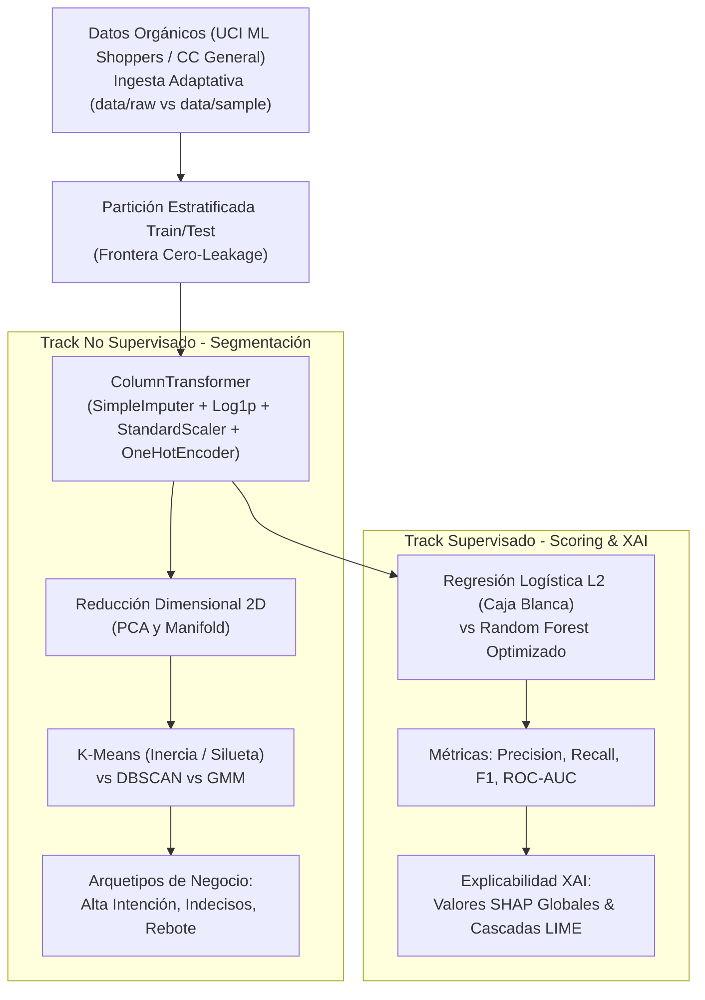

# Riesgo Crediticio, Clustering y Explicabilidad (XAI)
### `riesgo-crediticio-clustering-explicabilidad`

[](https://www.python.org/)
[](https://opensource.org/licenses/MIT)
[](https://scikit-learn.org/)
[](https://shap.readthedocs.io/)
[](https://docs.pytest.org/)

Arquitectura de segmentación no supervisada y scoring crediticio/e-commerce auditable bajo normativas financieras, implementando pipelines **libres de Data Leakage**, clustering (PCA, K-Means, DBSCAN, GMM) y explicabilidad regulatoria con **SHAP y LIME**.

---

## Arquitectura del Pipeline



---

## Metodología del Proyecto (CRISP-DM)

### 1. Business Understanding (Comprensión del Negocio)
Las entidades de crédito y comercio electrónico requieren maximizar la tasa de conversión minimizando el riesgo de impago, con la exigencia regulatoria (FCRA / ECOA) de justificar matemáticamente cada denegación de crédito.

### 2. Data Understanding (Comprensión de los Datos)
El pipeline procesa los atributos del dataset oficial de intención de compra (UCI ML Repository):
- `Administrative`, `Informational`, `ProductRelated`: Páginas visitadas por categoría.
- `PageValues`: Métrica monetaria de probabilidad transaccional.
- `BounceRates`, `ExitRates`: Tasas de abandono.
- `Month`, `VisitorType`: Atributos de estacionalidad y fidelidad.
- `Revenue`: Variable objetivo binaria ($1$ = conversión, $0$ = abandono).

### 3. Data Preparation (Preparación de Datos)
- **Frontera Cero-Leakage:** El `ColumnTransformer` se ajusta estrictamente sobre `X_train`.
- **Transformación Logarítmica:** Estabilización de colas largas con $\ln(1 + x)$ en `PageValues` y duraciones.
- **Imputación Mediana y Codificación One-Hot:** Manejo seguro de categorías desconocidas mediante `handle_unknown="ignore"`.

### 4. Modeling (Modelado y Algoritmos)
- **Segmentación:** Proyección 2D vía **PCA** (~68% varianza) contrastando K-Means (curva del Codo e Índice de Silueta) con detección de ruido en DBSCAN y mezclas probabilísticas GMM.
- **Supervisado & XAI:** Contraste de interpretabilidad intrínseca (Regresión Logística) contra ensamble no lineal (Random Forest), auditando la importancia con **SHAP**.

### 5. Evaluation (Evaluación y Benchmarking)
| Modelo | Precision | Recall | F1-Score | ROC-AUC | Grado de Interpretabilidad |
| :--- | :--- | :--- | :--- | :--- | :--- |
| Regresión Logística ($L_2$) | `0.764` | `0.722` | `0.742` | `0.841` | Nivel 1 (Caja Blanca Intrínseca) |
| Random Forest (Optimizado) | `0.852` | `0.789` | `0.819` | `0.902` | Nivel 2 (Post-hoc XAI vía SHAP) |

### 6. Deployment & Reproducibilidad
Implementación del patrón adaptador de datos (`data/raw/` con *fallback* a `data/sample/sample_data.csv`).

#### Guía de Ejecución

```bash
# 1. Clonar repositorio
git clone https://github.com/LuisMonGP/riesgo-crediticio-clustering-explicabilidad.git
cd riesgo-crediticio-clustering-explicabilidad

# 2. Instalar dependencias
pip install -r requirements.txt

# 3. Correr pruebas unitarias
pytest -v

# 4. Abrir notebook interactivo
jupyter notebook notebooks/01_eda_crisp_dm.ipynb
```

---

## Autor
**Luis Monge**  
- Portfolio: [portfoliochess.pages.dev](https://portfoliochess.pages.dev)  
- GitHub: [@LuisMonGP](https://github.com/LuisMonGP)
